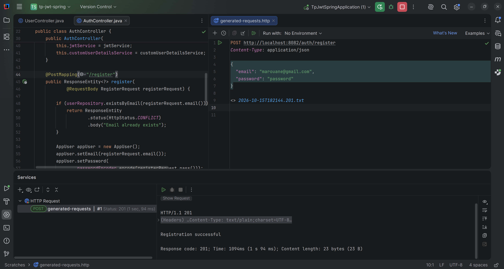

# JWT authentication with Spring Boot

Spring Boot application using Java 21, Spring Security, JWT, Spring Data JPA, and an in-memory H2 database. Java packages use `net.ma7boub.tpjwtspring`.

## Run

Install Java 21 and run:

```bash
./mvnw spring-boot:run
```

The API runs at `http://localhost:8082`. In IntelliJ, run `net.ma7boub.tpjwtspring.TpJwtSpringApplication`.

## Register

```http
POST http://localhost:8082/auth/register
Content-Type: application/json

{
  "email": "marouane@gmail.com",
  "password": "password"
}
```

Returns **201 Created** with `Registration successful`. Registering the same email again returns **409 Conflict**. Use login to obtain a token for an existing account.



## Login and receive a token

```http
POST http://localhost:8082/auth/login
Content-Type: application/json

{
  "email": "marouane@gmail.com",
  "pass": "password"
}
```

Both `pass` and `password` are accepted on registration and login. A successful login returns **200 OK**:

```json
{
  "token": "<JWT>"
}
```

Missing or blank credentials return **400 Bad Request**. Incorrect credentials or an unknown account return **401 Unauthorized**.

The H2 database is in memory: restarting the application removes registered accounts. Register again after a restart, then log in with the same credentials.

## Call protected endpoints

Copy the token from the login response:

```http
GET http://localhost:8082/api/profile
Authorization: Bearer <JWT>
```

`GET /api/hello` also requires a token. Tokens expire after one hour.

## Tests

```bash
./mvnw test
```

The H2 console is available at `http://localhost:8082/h2-console`, using JDBC URL `jdbc:h2:mem:securitydb`, username `sa`, and an empty password. The bundled configuration and signing secret are for local practice.
