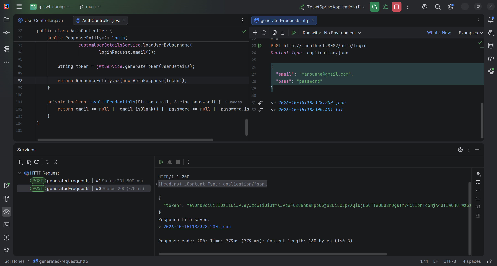
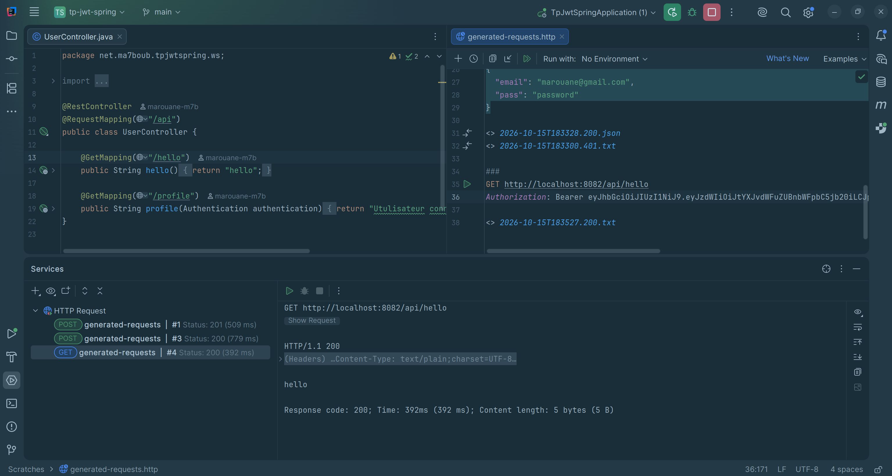
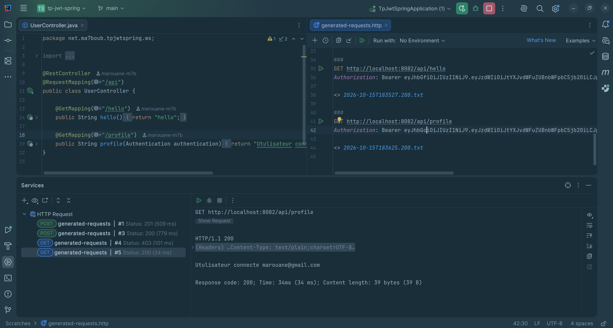
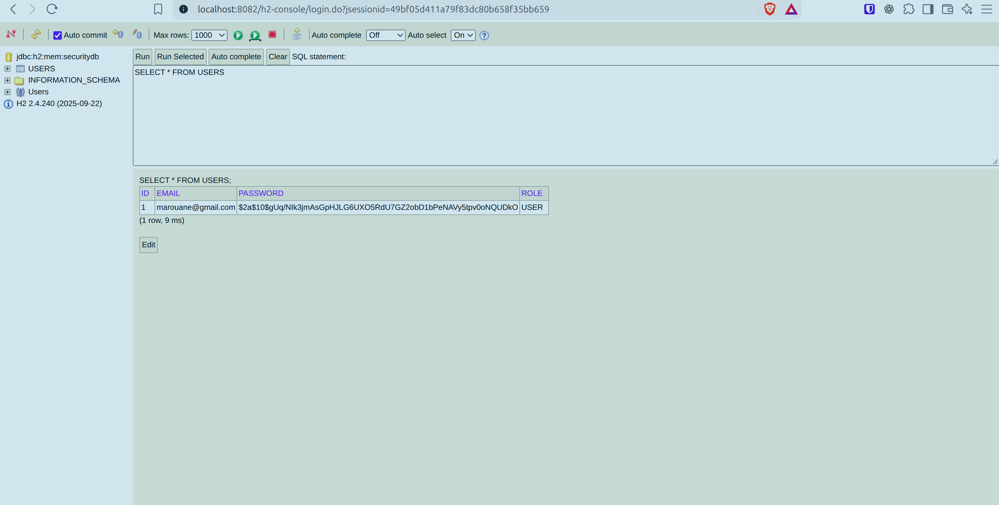

# ENSET — TP Sécurité : authentification JWT avec Spring Boot

Ce travail pratique met en place une API REST sécurisée : un utilisateur crée un compte, se connecte pour obtenir un jeton JWT, puis utilise ce jeton pour accéder aux ressources protégées. Les captures ci-dessous présentent les résultats obtenus pendant les essais.

## 1. Technologies utilisées

| Technologie | Utilisation dans le projet |
| --- | --- |
| Java 21 et Spring Boot | Développement et démarrage de l’application |
| Spring Security | Authentification et protection des routes |
| JWT et JJWT | Génération et vérification des jetons signés |
| BCrypt | Hachage des mots de passe |
| Spring Data JPA et H2 | Enregistrement et consultation des utilisateurs |
| Maven Wrapper | Exécution du projet et des tests |
| Client HTTP IntelliJ | Envoi des requêtes et observation des réponses |

## 2. Travail réalisé

Nous avons mis en place les fonctionnalités suivantes :

- **Gestion des utilisateurs** : création de l’entité `AppUser`, du dépôt `UserRepository` et des objets de requête et de réponse.
- **Inscription** : vérification de l’adresse déjà enregistrée, hachage BCrypt du mot de passe et attribution du rôle `USER`.
- **Connexion** : vérification des identifiants avec Spring Security et retour d’un JWT dans une réponse JSON.
- **Sécurisation des ressources** : ajout du filtre `JwtFilter`, qui vérifie le jeton et renseigne le contexte de sécurité pour les requêtes authentifiées.
- **Configuration sans session serveur** : utilisation de `SessionCreationPolicy.STATELESS`. Le client transmet son jeton dans chaque requête protégée.
- **Correction du problème de connexion** : prise en charge des champs JSON `pass` et `password`, à l’inscription comme à la connexion. Les identifiants manquants renvoient désormais `400` et les identifiants incorrects `401`.
- **Organisation du projet** : remplacement du préfixe de package `org.example` par `net.ma7boub`, mise à jour de la configuration de lancement et suppression des anciens fichiers du rapport LaTeX/PDF.
- **Documentation et vérification** : regroupement des captures dans `docs/images/` et ajout de tests d’intégration pour le parcours d’authentification.

Le dossier du projet s’appelle désormais **`ENSET_TP_SECURITY_JWT`**. Le package Java principal reste **`net.ma7boub.tpjwtspring`**.

## 3. Organisation du code

```text
ENSET_TP_SECURITY_JWT/
├── README.md
├── docs/images/                 # Captures des résultats
├── pom.xml                      # Configuration Maven
├── mvnw / mvnw.cmd              # Maven Wrapper
└── src/
    ├── main/
    │   ├── java/net/ma7boub/tpjwtspring/
    │   │   ├── config/          # Configuration Spring Security
    │   │   ├── dto/             # Requêtes et réponse contenant le JWT
    │   │   ├── entity/          # Entité utilisateur
    │   │   ├── repo/            # Accès aux utilisateurs
    │   │   ├── security/        # Filtre JWT
    │   │   ├── service/         # Gestion des JWT et chargement des utilisateurs
    │   │   └── ws/              # Contrôleurs REST
    │   └── resources/application.properties
    └── test/                    # Tests du contexte et de l’authentification
```

## 4. Lancement de l’application

Prérequis : **JDK 21** et accès à Internet au premier lancement pour télécharger les dépendances Maven.

```bash
cd ~/Desktop/Security/ENSET_TP_SECURITY_JWT
./mvnw spring-boot:run
```

Sous Windows :

```powershell
.\mvnw.cmd spring-boot:run
```

Dans IntelliJ IDEA, ouvrir le projet Maven et lancer la classe :

```text
net.ma7boub.tpjwtspring.TpJwtSpringApplication
```

L’API écoute sur **http://localhost:8082**. Après le changement de package, une ancienne configuration IntelliJ pointant vers `org.example.tpjwtspring.TpJwtSpringApplication` doit être remplacée par la classe ci-dessus.

## 5. Fonctionnement de l’authentification

1. Le client envoie son adresse électronique et son mot de passe à `/auth/register`.
2. Le serveur stocke l’utilisateur avec un mot de passe haché en BCrypt.
3. Le client envoie les mêmes identifiants à `/auth/login`.
4. Si les identifiants sont corrects, le serveur retourne un JWT signé, valable **une heure**.
5. Le client ajoute `Authorization: Bearer <JWT>` à ses appels vers `/api/**`.
6. Le filtre vérifie le jeton avant de permettre l’accès à la ressource protégée.

Les routes `/auth/**` et `/h2-console/**` sont accessibles sans authentification dans la configuration du TP. Les routes `/api/hello` et `/api/profile` nécessitent un utilisateur authentifié.

## 6. Requêtes et résultats obtenus

Les exemples suivants peuvent être exécutés depuis le client HTTP d’IntelliJ. Remplacer `<JWT>` par la valeur reçue à la connexion, sans les chevrons.

### 6.1. Inscription d’un utilisateur

```http
POST http://localhost:8082/auth/register
Content-Type: application/json

{
  "email": "marouane@gmail.com",
  "password": "password"
}
```

**Résultat obtenu : `201 Created`**, avec le message :

```text
Registration successful
```

Le compte est créé avec le rôle `USER`. Une nouvelle inscription avec la même adresse retourne **`409 Conflict`** et `Email already exists`. Pour un compte déjà inscrit, il faut utiliser la connexion afin d’obtenir un jeton.


### 6.2. Connexion et récupération du JWT

```http
POST http://localhost:8082/auth/login
Content-Type: application/json

{
  "email": "marouane@gmail.com",
  "pass": "password"
}
```

**Résultat obtenu : `200 OK`**, avec une réponse JSON contenant le jeton :

```json
{
  "token": "<JWT>"
}
```

Les noms `pass` et `password` sont tous les deux acceptés à l’inscription et à la connexion. Cette compatibilité corrige l’incohérence entre les requêtes qui utilisaient `password` et les objets Java qui attendaient `pass`.



### 6.3. Accès à la route protégée `/api/hello`

```http
GET http://localhost:8082/api/hello
Authorization: Bearer <JWT>
```

**Résultat obtenu : `200 OK`**, avec le contenu :

```text
hello
```

La réponse montre qu’une requête munie d’un jeton valide peut accéder à cette ressource protégée.



### 6.4. Consultation du profil authentifié

```http
GET http://localhost:8082/api/profile
Authorization: Bearer <JWT>
```

**Résultat obtenu : `200 OK`**. La réponse identifie l’utilisateur connecté :

```text
Utulisateur connecte marouane@gmail.com
```

Ce texte correspond à la réponse actuelle du contrôleur. L’adresse retournée provient de l’identité authentifiée dans le contexte de sécurité.



### 6.5. Vérification des données dans H2

Ouvrir **http://localhost:8082/h2-console** avec les paramètres suivants :

| Paramètre | Valeur |
| --- | --- |
| URL JDBC | `jdbc:h2:mem:securitydb` |
| Utilisateur | `sa` |
| Mot de passe | Vide |

Exécuter :

```sql
SELECT * FROM USERS;
```

**Résultat observé :** la table contient le compte inscrit, son adresse électronique, un mot de passe haché BCrypt et le rôle `USER`. Le mot de passe en clair n’est pas enregistré dans la table.



## 7. Gestion des erreurs et tests

| Situation | Résultat |
| --- | --- |
| Inscription avec des identifiants renseignés et une nouvelle adresse | `201 Created` |
| Adresse déjà enregistrée lors de l’inscription | `409 Conflict` |
| Connexion avec les bons identifiants | `200 OK` et un JWT |
| Adresse ou mot de passe absent ou vide | `400 Bad Request` |
| Mot de passe incorrect ou compte inconnu à la connexion | `401 Unauthorized` |
| Appel d’une ressource protégée sans authentification | Accès refusé (`403` dans la configuration actuelle) |
| Appel de `/api/hello` ou `/api/profile` avec un JWT valide | `200 OK` |

Les vérifications HTTP réalisées ont confirmé l’inscription avec les deux noms de champ (`pass` et `password`), la connexion avec l’un ou l’autre, l’obtention d’un JWT, l’accès au profil, le refus des doublons et les réponses aux identifiants incorrects ou manquants.

Les tests d’intégration ajoutés dans `AuthIntegrationTests` couvrent ces principaux scénarios. Pour lancer la suite Maven :

```bash
./mvnw test
```

## 8. Points à retenir pour reproduire les résultats

- **La base H2 est en mémoire** : les comptes disparaissent à chaque redémarrage. Il faut donc s’inscrire à nouveau avant de se connecter après un redémarrage.
- **Le jeton expire après une heure** : effectuer une nouvelle connexion pour en obtenir un autre.
- **L’inscription ne retourne pas de jeton** : elle crée le compte. La connexion retourne le JWT.
- **La configuration est destinée au TP local** : la console H2 est accessible et le secret JWT est défini dans `application.properties`.

Les résultats illustrent le parcours complet : **inscription → connexion → obtention du JWT → accès aux ressources protégées**, avec vérification du stockage du compte dans H2.
